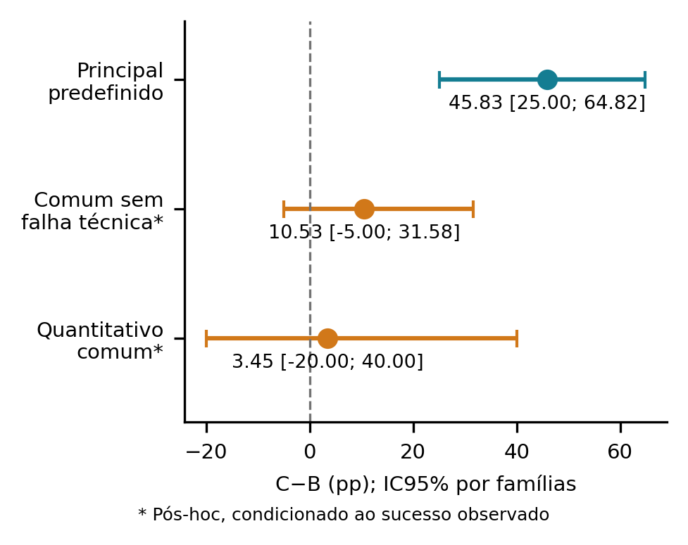
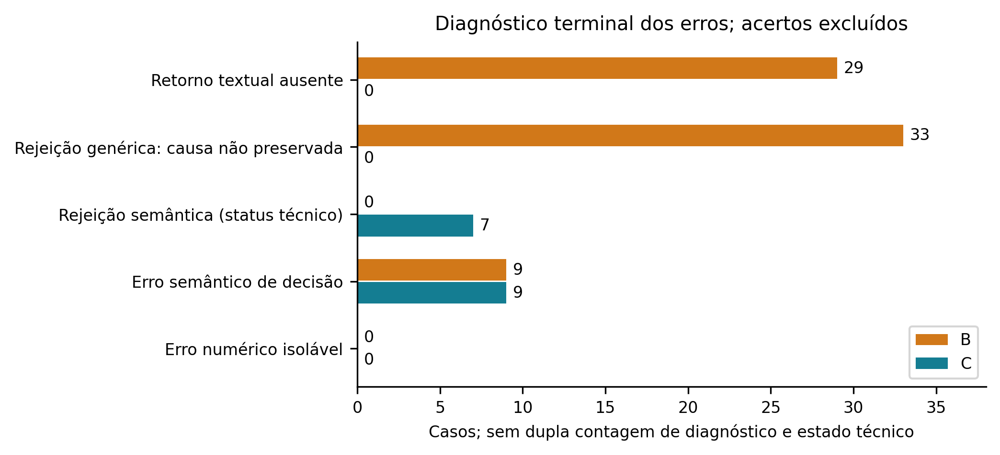
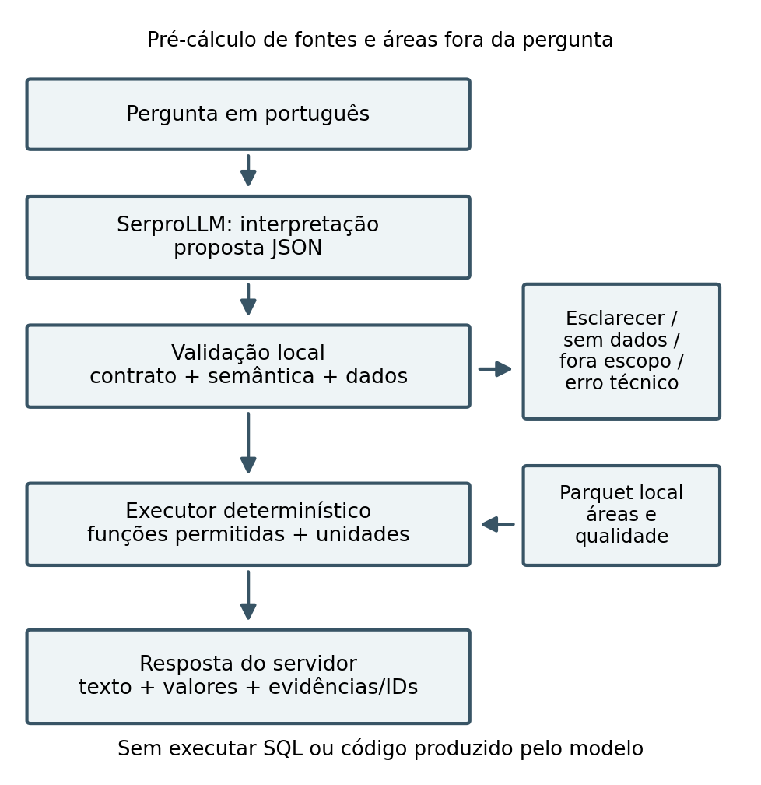

# Revisão científica V2 — análises exploratórias e proveniência


A versão anterior foi preservada. Não houve nova chamada de modelo nem mudança no benchmark, escores, prompts, executor ou resultados individuais. As análises a seguir são pós-hoc, solicitadas após observar o teste; não foram pré-registradas. O contraste principal continua sendo o protocolo congelado.


## Separação de falhas e sensibilidade B/C


| Condição | Diagnóstico observável | Casos |
| --- | --- | --- |
| B | acerto | 49 |
| B | retorno_textual_ausente | 29 |
| B | outra_falha_gateway | 0 |
| B | rejeicao_semantica | 0 |
| B | rejeicao_contrato_indeterminada | 33 |
| B | erro_semantico_decisao | 9 |
| B | erro_semantico_plano | 0 |
| B | erro_estrutura_resultado | 0 |
| B | erro_numerico_isolavel | 0 |
| B | outro_indeterminado | 0 |
| C | acerto | 104 |
| C | retorno_textual_ausente | 0 |
| C | outra_falha_gateway | 0 |
| C | rejeicao_semantica | 7 |
| C | rejeicao_contrato_indeterminada | 0 |
| C | erro_semantico_decisao | 9 |
| C | erro_semantico_plano | 0 |
| C | erro_estrutura_resultado | 0 |
| C | erro_numerico_isolavel | 0 |
| C | outro_indeterminado | 0 |


A taxonomia é mutuamente exclusiva por caso/condição e distingue o estado original de erro técnico de sua causa observável. Em C, divergência de anos/operação/território permite identificar rejeição semântica. Em B, value_error genérico não preserva a razão; não é correto classificá-lo retroativamente como erro JSON, semântico ou numérico. Os registros brutos descartados não foram reconstruídos por inferência.


| Subconjunto | n | Famílias | Acertos B | Acertos C | Δ pp [IC95%] |
| --- | --- | --- | --- | --- | --- |
| ambas_sem_erro_tecnico | 57 | 13 | 48 | 54 | 10,53 [-5,00; 31,58] |
| ambas_sem_erro_tecnico_gabarito_quantitativo | 29 | 6 | 25 | 26 | 3,45 [-20,00; 40,00] |


Os mesmos case_ids são mantidos em B e C em cada subconjunto. Bootstrap pareado por famílias, 10000 réplicas, seed 20271020; o IC principal usa a seed e definição originalmente congeladas. A seleção por status observado pode introduzir viés de seleção e não torna os contratos equivalentes. Não selecionar o subconjunto como novo resultado principal. O intervalo do subconjunto comum inclui zero; não se conclui equivalência nem ausência de efeito. Poucas famílias nos subconjuntos limitam a estabilidade do bootstrap.


| Condição | Sem falha própria | Acertos | Taxa condicional | Quantitativos com semântica válida | Erros numéricos isoláveis |
| --- | --- | --- | --- | --- | --- |
| B | 58 | 49 | 84,48% | 26 | 0 |
| C | 113 | 104 | 92,04% | 73 | 0 |


As taxas condicionais por condição têm denominadores diferentes e não devem ser subtraídas como se fossem pareadas. Um erro numérico só é isolável se status, plano, entidades, anos, unidades e estrutura do resultado estiverem coerentes. Zero erro isolável nos casos avaliáveis não permite inferir desempenho aritmético nos casos rejeitados.


### Decomposição descritiva do contraste completo


| B técnico | C técnico | Casos | Acertos B | Acertos C | Contribuição pp no total |
| --- | --- | --- | --- | --- | --- |
| False | False | 57 | 48 | 54 | 5,00 |
| True | False | 56 | 0 | 50 | 41,67 |
| False | True | 1 | 1 | 0 | -0,83 |
| True | True | 6 | 0 | 0 | 0,00 |


As contribuições usam o denominador completo e somam a diferença principal; não são estimativas causais de quanto o contrato explica. Casos com erro técnico apenas em B podem diferir em dificuldade daqueles em que ambas concluem.








## Proveniência revisada


| Ano | Arquivo original | Geração GCS conferida | Intervalos iguais | Intervalos registrados | SHA-256 do recorte |
| --- | --- | --- | --- | --- | --- |
| 2015 | brazil_coverage-col11_2015.tif | 1787144389260083 | 185 | 185 | 99c7a24c07d0b6cf29969ea2385592b9f3e0845b667b1877c7e163e3fd17739a |
| 2025 | brazil_coverage-col11_2025.tif | 1787089134874800 | 204 | 204 | 8b848eb7e2592f26160835b9b256987e985fd39d1dbb2681aa722b9aa8e355b7 |


Aquisição histórica por janela: `2026-10-19T16:27:57.264890+00:00`; estratégia `staging_regional_range_uma_abertura_por_ano`; sem reamostragem ou overviews. Manifest `artifacts/staging/33d91b08a0bec1900a406d91e81d6cc9e0eccca058471253198e3249d70a7c1d/manifest.json` SHA-256 `c38bda88c67d6a07021536e7a4ffe4549bab897c08de18f001047c40bd213815`. URLs do espelho, tamanhos, ETags, Last-Modified, offsets, comprimentos e hashes dos intervalos estão em `proveniencia.json`. ETag não é SHA-256. Os recortes nativos não são os arquivos nacionais originais.


Verificação pública: `verificado_intervalos_utilizados` em `2026-10-20T13:55:05.087918+00:00`. A página oficial, seu hash e o asset GEE divulgado foram registrados. As gerações GCS fixam os objetos remotos usados na conferência; não são rótulos de revisão temática. O MD5/CRC32C reportado pelo GCS é metadado do objeto oficial e não foi calculado sobre o raster nacional do espelho. A igualdade dos intervalos utilizados não implica igualdade integral nacional, acurácia temática ou vínculo automático ao asset GEE coverage_v3.


Snapshot `data/mesh_RN_v1.json` obtido em `2026-10-19T16:20:39.783206+00:00`, `EPSG:4326`, 168 entidades. Fonte comprovada: tabelas internas `sbsr.municipios, sbsr.uf`, acesso somente leitura. Hash lógico `3207282d98e5fc1d01d48008dbe5264150728a4c62d3ba41e0ead57a48444bd0`; hash do arquivo `42850b2d17fbfe9279f09e25417ec94a679b3d4080705a18374feaeceaf98b11`. Provedor e arquivo originais, edição, data de publicação e licença não identificados. A data de extração não é data da malha. Não atribuir origem IBGE apenas pelos códigos.


Nova busca de comentários de catálogo: `indisponivel`; motivo `configuracao_ausente`. Se a configuração estiver ausente, nenhuma conexão foi realizada. O diagnóstico anterior e o snapshot local foram preservados.


Não houve substituição de raster, malha ou estatística para aproveitar uma proveniência mais clara. Uma nova malha/revisão exige execução própria e reavaliação. Snapshot/estatísticas continuam sem liberação de redistribuição pela licença da malha não comprovada.


## Arquitetura e exemplo real





Fontes, snapshot e cálculo fracionário são materializados antes da pergunta. A proposta textual é validada em contrato e semântica. O executor consulta somente derivados da execução escolhida e o servidor renderiza números/evidências. Ambiguidade retorna esclarecimento; falta de cobertura, fora de escopo e erro técnico têm saídas próprias. SQL/código do modelo não são executados.


Em 2015, quantos hectares de Formação Florestal foram mapeados no município de Acari/RN?


```json

{
  "operation": "area",
  "metric": "area",
  "unit": "ha",
  "territory_codes": [
    "2400109"
  ],
  "scope_uf": null,
  "class_codes": [
    3
  ],
  "years": [
    2015
  ],
  "denominator": null,
  "direction": "desc",
  "limit": null
}

```


Operação determinística: soma das areas anuais das classes folha selecionadas, na particao e territorio solicitados. m2 no Parquet; conversao /10000 para ha.


Acari/RN (IBGE 2400109): área mapeada de Formação Florestal [3], em 2015: 14,69 ha.
Coleção 11; revisão desconhecida; malha edição desconhecida; método ellipsoid-linear-lonlat-fractional-v1; execução a98ccf54c8c82ceeb601ce126cdb379add4de253912a46267601cdc7d9a29802.
Mudança observada na classificação não comprova mudança real específica no terreno, causas ou ilegalidade.


Registro original: `artifacts/evaluation/test_v1/individual/t01_1_C_0.json`, SHA-256 `2d2fe262a8812755f3b629a20d633feb5ca4cc15e25f7285b94b98b26c369499`. Answer ID `d5efba7387126d4a983dad520c8edb6a3522182f2cba8c22b5ce9fbff16a3c1b`; evidência `5017672376a8d825d4c7bcf13366bd75f5023c3c6ed71531603da754219f7292`. O exemplo é um acerto existente selecionado por regra declarada, não um novo teste de inferência. Plano, valor integral, método, qualidade e fontes completas estão em `exemplo_real.json`.


## Condição equivalente futura — não executada


Para isolar o papel do cálculo, uma nova avaliação deverá congelar um corpus independente e um contrato final comum de fatos (status, entidades resolvidas, unidade, valor e IDs de fonte), com os mesmos fatos disponíveis, orçamento e política de esclarecimento. A execução com cálculo e a sem cálculo devem entregar o mesmo envelope; registrar separadamente a interpretação. Isso exige novo protocolo e execução reais, não recodificar este teste como uma condição equivalente. A revisão atual implementa apenas a alternativa mínima de sensibilidade solicitada.


## Texto e resultados anteriores para contexto


# Consolidação científica — rascunho para revisão autoral


Resultados reais já executados; autoria, afiliações, revisão humana e direitos de alguns insumos continuam pendentes. Não houve submissão, publicação de repositório ou deploy. Este documento e as figuras são gerados por script a partir das saídas individuais auditadas.


## Problema, fontes e escopo


Avalia-se uma arquitetura de consultas em português sobre cobertura e uso da terra. O recorte é RN, anos 2015–2025, Coleção 11, com 167 municípios e estatística direta de UF. Há 22176 registros de área e 672 de qualidade; a auditoria conferiu 336 Parquets. O universo foi materializado, mas 166 municípios são elegíveis no suporte comum. Ranking completo permanece indisponível por código desconhecido zero. Isso é falha de qualidade conhecida, não falta de processamento nem zero real de classe.


Execução geoespacial `a98ccf54c8c82ceeb601ce126cdb379add4de253912a46267601cdc7d9a29802`; malha `3207282d98e5fc1d01d48008dbe5264150728a4c62d3ba41e0ead57a48444bd0`; catálogo `04f699fe08ce817f759c9923d38cb71d817722bee37c3f2322d8419e32963660`. Edição territorial e revisão oficial são desconhecidas. SHA-256 dos recortes identifica os bytes usados; ETag do espelho não é hash integral nacional nem certificação de revisão oficial.


## Método de área e limites


O método ellipsoid-linear-lonlat-fractional-v1 integra área no elipsoide WGS84, sobre segmentos lineares no CRS EPSG:4326. Interseções GEOS fracionam pixels de borda; área interior varia por faixa de latitude. A quadratura Gauss–Legendre segue a geometria nativa, com buracos e componentes múltiplos. Não há interpolação de códigos, overviews para área ou multiplicação uniforme por 900 m². A integração é elipsoidal, distinta de área esférica e cartesiana em graus.


A identidade de superfície é dS = a²(1−e²) cosφ / (1−e² sen²φ)² dφ dλ. Sua primitiva Q permite área do pixel por Δλ·[Q(φN)−Q(φS)] e do polígono por −∮Q(φ)dλ. O caminho independente usa geodésicas densificadas por PROJ/Geod, com aproximação distinta das arestas lineares lonlat. Tolerâncias de conservação e concordância controlam erro numérico, sem validar tema, posição ou verdade de campo.


Usou-se uma malha fixa e hashada nos dois anos, com reparos somente derivados e diagnosticados. Comparações consomem áreas comparáveis na interseção de máscaras válidas e classes reconhecidas; áreas anuais de suportes distintos não são subtraídas automaticamente. Água mapeada não identifica evento de inundação; diferença líquida não identifica perda bruta ou causalidade.


## Operações e semântica


Área usa a união de classes folha; participação = 100×classe/área observada; diferença líquida = final−inicial; redução = max(0,inicial−final); variação percentual = 100×(final−inicial)/inicial; pontos percentuais = participação final−inicial. Base zero exige null com motivo. Conversões partem de hectare. Grupos são conjuntos, sem dupla contagem de pai e filho. Homônimos, floresta genérica, unidade/denominador ausente exigem esclarecimento. Perda bruta requer matriz de transição ausente no MVP.


## Arquitetura, B e protocolo


A usa documentação sem áreas; B recebe as mesmas definições mais tabelas suficientes, sem resposta pronta e sem ferramenta de cálculo; C interpreta um plano, valida semântica/capacidades, calcula deterministicamente e publica o template do servidor. A suficiência e os bytes das tabelas de B foram reconciliados com os mesmos derivados usados por C. Os contratos de saída B/C têm complexidades diferentes. A política local antecipa recusas para conceitos proibidos, inclusive antes do gateway em algumas questões.


Modelo informado `MODEL_ID`, retornado `RETURNED_MODEL_ID_1`; temperatura 0, saída 2048 tokens, timeout 60 s, 3 workers e um reparo máximo. Identificador igual não prova revisão dos pesos. O protocolo separa 40 questões de desenvolvimento e 120 de teste; 88 destas têm referência quantitativa. São 15 famílias de teste, com perguntas por molduras. As saídas contêm 360 registros principais e 12 repetições.


Gabaritos usam Decimal e leitura direta dos Parquets, sem as métricas/executor de produção. O sistema, prompts, critérios, referências e tolerâncias foram congelados antes das chamadas de teste. A correção do ambiente de desenvolvimento (cópias locais substituindo links simbólicos bloqueados) foi concluída antes do teste, preservando a execução diagnóstica. Não se ajustou o sistema a partir do teste. A revisão semântica foi assistida por IA e por invariantes, sem avaliação humana ou concordância entre anotadores.


## Resultados principais


| Condição | Acerto | Taxa | Respondida | Precisão emitida | Abstenção não técnica | Erro técnico |
| --- | --- | --- | --- | --- | --- | --- |
| A | 21/120 | 17,50% | 0,00% | não definida | 120 | 0 |
| B | 49/120 | 40,83% | 25,00% | 86,67% | 28 | 62 |
| C | 104/120 | 86,67% | 60,83% | 100,00% | 40 | 7 |


Diferença C−B = **45,83 pontos percentuais**, IC95% **[25,00; 64,82]**, por 10000 réplicas e seed 20271019. A reamostragem preserva todos os casos e condições da família sorteada e pondera pelo número de casos resultante. Esse intervalo não expressa incerteza de hectares nem acurácia temática.


Abstenção não técnica soma esclarecimento, fora de escopo e ausência de dados. Falha técnica é apresentada separadamente. A métrica histórica de não resposta inclui falhas e permanece disponível nas tabelas, sem ser confundida com abstenção deliberada. Respostas com valor legitimamente indefinido podem ter estado respondida.


## Tipos de erro


| Condição | Tipo diagnóstico | Casos |
| --- | --- | --- |
| A | acerto | 21 |
| A | status_incorreto | 99 |
| B | acerto | 49 |
| B | status_incorreto | 9 |
| B | texto_final_ausente | 29 |
| B | validacao_apos_limite | 33 |
| C | acerto | 104 |
| C | esclarecimento_incorreto | 1 |
| C | status_incorreto | 8 |
| C | validacao_apos_limite | 7 |


B teve 62 casos técnicos, incluindo saída/contrato inválido após o limite e texto final ausente. C teve 7 falhas após validação. Não se inferiu causa remota para texto final ausente nem exaustão de tokens sem evidência. O efeito principal é de confiabilidade ponta a ponta sob orçamento e contrato fixos. Não é uma estimativa isolada de habilidade aritmética.


## Latência, tokens e repetibilidade


| Condição | Média s | Mediana s | p95 s | Tokens observados | Tentativas sem usage | Custo |
| --- | --- | --- | --- | --- | --- | --- |
| A | 5,39 | 4,47 | 11,53 | 474281 | 0 | null |
| B | 12,39 | 11,31 | 24,00 | 874526 | 29 | null |
| C | 10,21 | 8,51 | 21,43 | 701151 | 0 | null |


Os tokens são contadores observados, parciais quando faltou usage. Nenhum preço ou consumo ausente foi estimado. Latência inclui carga local e autenticação, com três workers; não isola tempo de inferência nem normaliza hardware/servidor. As repetições predefinidas não entram no acerto principal nem selecionam a melhor resposta.


Repetibilidade: 11/12 respostas estruturadas iguais e 11/12 acertos iguais. Temperatura zero não garante determinismo.


## Dependência e validade externa


A divisão por famílias evita tratar paráfrases da mesma moldura como observações independentes. Entretanto, famílias compartilham classes, malha, revisão e uma UF; rankings dependem também de municípios vistos em desenvolvimento. A seleção de municípios canônicos distintos reduz vazamento direto e não comprova independência territorial. A sensibilidade por município é outro agrupamento de um subconjunto, não correção universal de dependência espacial.


O corpus foi construído por IA e por regras; ele não amostra a distribuição de perguntas de usuários reais. Há operações e vocabulário compartilhados entre desenvolvimento e teste. A amostra de revisão e os invariantes não substituem anotadores humanos independentes. Só há um identificador de modelo, um orçamento, dois anos e uma execução principal; a amostra de repetibilidade é limitada.


O benchmark valida respostas sobre referências derivadas, não a verdade dos mapas no terreno. O MapBiomas contém erros temáticos/posicionais e classes beta. Coleção não identifica sozinha a revisão do espelho. A malha fixa pode diferir das divisões históricas; sua origem licenciada/edição não foram comprovadas. O método de borda controla integração física, sem remover incerteza da geometria e do raster. Não há comparação equivalente com estatísticas oficiais. Não se atribuem causas ou ilegalidade a diferenças marginais.


## Normas, eixo e rascunho


Consulta das normas: 2026-10-20T14:02:03.711247+00:00. A chamada ainda informa prazo 2026-10-30 e até 4 páginas em PDF, incluindo todos os elementos, sem numeração. O modelo ODT vinculado foi obtido e hashado. O eixo principal proposto é 3. Geoinformática, subárea Inteligência artificial. Não foi atribuído número de subárea não confirmado pelo formulário.


O ODT vinculado usa Letter, enquanto o LaTeX vinculado declara A4; preservou-se a geometria ODT e registrou-se a divergência. Foram seguidas as instruções textuais de fonte/tamanho quando estilos herdados divergiam. A contagem de páginas será verificada no PDF renderizado. Autoria/afiliações continuam como marcadores, sem inclusão de pessoas presumidas.


## Uso de IA e integridade


Proposta de declaração: IA assistiu implementação, redação, construção de questões e revisão. O LLM foi objeto das condições experimentais. O assistente de desenvolvimento foi Codex; a versão exata do assistente não foi registrada nos artefatos. Não houve revisão humana do benchmark. Os autores reais deverão confirmar contribuições, revisar os textos e assumir responsabilidade por fontes, resultados e decisões.


Não foi identificada cláusula específica sobre IA generativa na chamada, no ODT e nos eixos consultados. Isso não estabelece ausência de outras normas aplicáveis. A política institucional dos autores permanece a confirmar. A chamada contém disposições gerais de integridade/autoria; não se importaram regras de outros eventos. IA não foi incluída como autora. Nenhuma submissão foi realizada.


## Artefatos, direitos e reprodução


A lista de publicação proposta está em publicacao/INVENTARIO.md. A verificação técnica de credenciais, caminhos e metadados não concede licença. O portal MapBiomas declara CC BY 4.0 com referência; a revisão exata do espelho e a licença da malha não foram identificadas. A licença atual do código é restritiva e a do benchmark deve ser definida pelo titular. Recortes/geometrias e estatísticas que dependem dessa malha permanecem condicionados à verificação de direitos. A originalidade do código e a política institucional devem ser confirmadas antes de publicar.


Reprodução: execute o script consolidar_etapa8.py, com o ambiente principal para auditoria/estatística e um processo de plotagem compatível. O comando e dependências verificadas estão no guia de reprodução. O script não chama banco, gateway ou raster remoto, e não modifica entradas congeladas. Figuras, tabelas e números do texto usam consolidado.json e blocos_artigo.json.


## Bibliografia primária verificada


[1] C. M. Souza Jr. et al. Reconstructing Three Decades of Land Use and Land Cover Changes in Brazilian Biomes with Landsat Archive and Earth Engine. Remote Sensing 12(17), 2735, 2020. DOI: 10.3390/rs12172735.

[2] W. Chen, X. Ma, X. Wang e W. W. Cohen. Program of Thoughts Prompting: Disentangling Computation from Reasoning for Numerical Reasoning Tasks. arXiv:2211.12588v4, 2023. DOI: 10.48550/arXiv.2211.12588.

[3] Projeto MapBiomas. Coleção 11 da Série Anual de Mapas de Cobertura e Uso da Terra do Brasil: códigos de legenda. Documento de legenda oficial, 2026. Disponível em brasil.mapbiomas.org; acesso em 19 out. 2026.

[4] C. A. Field e A. H. Welsh. Bootstrapping clustered data. Journal of the Royal Statistical Society: Series B 69(3), 369–390, 2007. DOI: 10.1111/j.1467-9868.2007.00593.x.

[5] C. F. F. Karney. Algorithms for geodesics. Journal of Geodesy 87(1), 43–55, 2013. DOI: 10.1007/s00190-012-0578-z.


## Diagnóstico exploratório separado de contexto


Uma pergunta de desenvolvimento, uma execução por tamanho. Esse experimento não entra no teste principal e não mede a janela máxima do modelo.

| Municípios | Bytes úteis | Gateway | Estado | Acerto |
| --- | --- | --- | --- | --- |
| 1 | 12698 | True | respondida | True |
| 5 | 30174 | True | precisa_esclarecimento | False |
| 10 | 51889 | True | precisa_esclarecimento | False |
| 20 | 96067 | True | erro_tecnico | False |
| 40 | 183255 | False | limite local | não avaliado |
| 80 | 356977 | False | limite local | não avaliado |
| 167 | 733158 | False | limite local | não avaliado |

